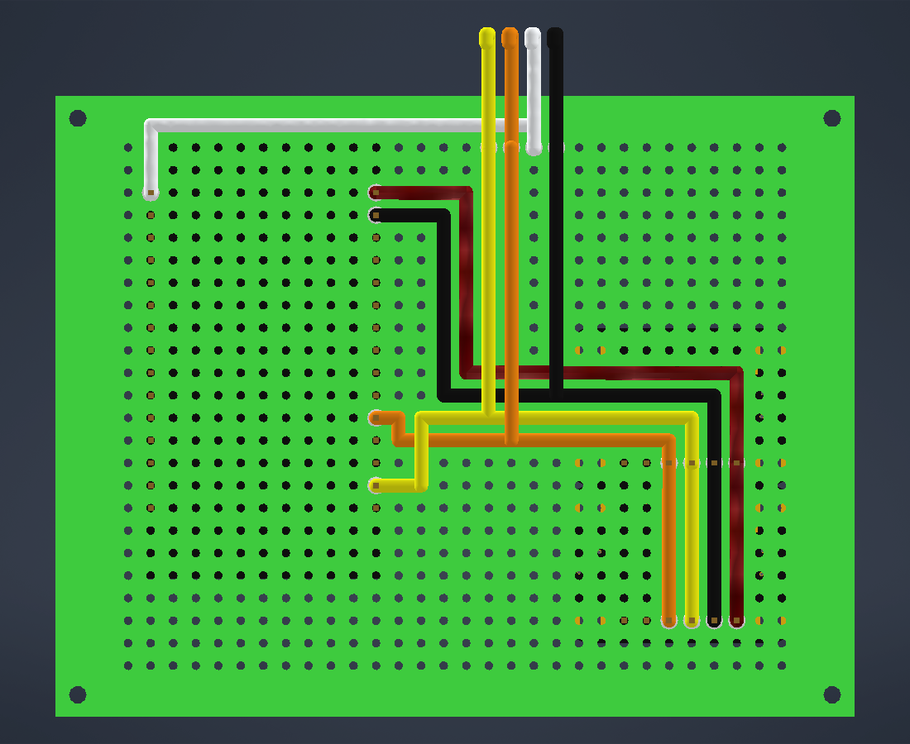

# Wiring

How to wire the reader's perf board: the ESP32 devkit, the TCS3448 and AS7343
sensor breakouts, and the 1602 I2C LCD. It matches
`hardware/enclosure/Electronics Assembly.iam` (wires in
`Electronics/Wiring.ipt`) and the firmware's pins in
[`firmware/main/board.h`](../firmware/main/board.h).



## Overview

```
  ESP32              TCS3448         AS7343          LCD backpack
  3V3 ───────────────── VIN ─────────── VIN
  GND ───────────────── GND ─────────── GND ─────────── GND
  D21 (SDA) ─────────── SDA ─────────── SDA ─────────── SDA
  D22 (SCL) ─────────── SCL ─────────── SCL ─────────── SCL
  VIN (5V) ──────────────────────────────────────────── VCC
```

One I2C bus (D21 = SDA, D22 = SCL) connects all three boards, which have
different addresses:

| Device | I2C address | Power |
|---|---|---|
| TCS3448 breakout (Adafruit 6525) | 0x59 | 3V3 |
| AS7343 breakout (Adafruit 6477) | 0x39 | 3V3 |
| 1602 LCD, PCF8574 backpack | 0x27 (some are 0x3F) | 5V (ESP32 VIN) |

The sensors' onboard white LEDs need no wires: the firmware switches them
over I2C (`--sensor-leds`, PR #20). ESP32 D4 drove the old separate LED and is
not needed with the onboard LEDs.

## Reading hole positions

Positions are **(column, row)** on the perf board's 30 × 24 hole grid.

- Look at the **solder side** (the side the wires go on, opposite the
  components) with the **ESP32's USB end at the top**.
- **Column 0** is the leftmost column of the grid and **row 0** is the bottom
  row. Ignore the larger pads along the board's short edges; they aren't part
  of the grid.

```
  solder side, USB end at the top

  row 23   . . . . . . . . . . . . . . . . . . . . . . . . . . . . . .    top edge
  row 22   . . . . . . . . . . . . . . . . . . . . . . . . . . . . . .
  row 21   . # . . . . . . . . . # . . . . . . . . . . . . . . . . . .    ESP32 VIN | 3V3
    ...      #                   #                                        (ESP32 underneath)
  row  7   . # . . . . . . . . . # . . . . . . . . . . . . . . . . . .    ESP32 EN  | D23
    ...
  row  0   . . . . . . . . . . . . . . . . . . . . . . . . . . . . . .
           ^ ^                   ^                     ^         ^   ^
     column 0 1                  11                    22        27  29
```

## Where each board sits

All three boards hang **below** the perf board (components facing down),
with their pins coming up through it. The LCD sits above, in the lid.

| Board | Pins in | Notes |
|---|---|---|
| ESP32 30-pin devkit | Columns **1** and **11**, rows **7–21** | USB toward the top edge; column 0 and rows 22–23 stay free |
| TCS3448 breakout | Row **9**, columns **22–27** | Board extends **up** (toward the top edge) from its header, so its white LED is on the top side of the sensor |
| AS7343 breakout | Row **2**, columns **22–27** | Same way round; its board's top edge touches the TCS3448's bottom edge |

Solder each breakout on its 1×6 header with the black plastic spacer
between the breakout and the perf board, pressing the breakout flat while you
solder so the sensor isn't tilted. Trim the pins on the solder side afterwards.

## Pin maps

**ESP32** (30-pin DOIT layout, checked against our board's silkscreen):

| Row | Column 1 | Column 11 |
|---|---|---|
| 21 | VIN (5V) | **3V3** |
| 20 | GND | **GND** |
| 19 | D13 | D15 |
| 18 | D12 | D2 |
| 17 | D14 | D4 (old LED, unused) |
| 16 | D27 | RX2 |
| 15 | D26 | TX2 |
| 14 | D25 | D5 |
| 13 | D33 | D18 |
| 12 | D32 | D19 |
| 11 | D35 | **D21 (SDA)** |
| 10 | D34 | RX0 |
| 9 | VN | TX0 |
| 8 | VP | **D22 (SCL)** |
| 7 | EN | D23 |

**Sensor headers** (same on both, in that board orientation):

| Column | 22 | 23 | 24 | 25 | 26 | 27 |
|---|---|---|---|---|---|---|
| Pin | INT | GPIO | **SDA** | **SCL** | **GND** | **VIN** |
| TCS3448 hole | (22, 9) | (23, 9) | (24, 9) | (25, 9) | (26, 9) | (27, 9) |
| AS7343 hole | (22, 2) | (23, 2) | (24, 2) | (25, 2) | (26, 2) | (27, 2) |

INT and GPIO aren't used.

**LCD pads** on the perf board, along row 23, for the leads up to the LCD:

| Hole | (16, 23) | (17, 23) | (18, 23) | (19, 23) |
|---|---|---|---|---|
| Net | SCL | SDA | 5V | GND |

## Wire list

22 AWG insulated wire on the solder side. Colours match the board as built.
"Cut" is the routed length plus 10 mm for stripping both ends, rounded up to the next 5 mm.

| # | Net | Colour | From | To | Route | Cut |
|---|---|---|---|---|---|---|
| 1 | SDA | orange | ESP32 D21 (11, 11) | TCS3448 SDA (24, 9) | Right to column 12, down to row 10, right along row 10 to column 24, down to the pin | 50 mm |
| 2 | SCL | yellow | ESP32 D22 (11, 8) | TCS3448 SCL (25, 9) | Right to column 13, up to row 11 (**crossing over wire 1**), right along row 11 to column 25, down to the pin | 65 mm |
| 3 | GND | black | ESP32 GND (11, 20) | TCS3448 GND (26, 9) | Right to column 14, down to row 12, right along row 12 to column 26, down to the pin | 80 mm |
| 4 | 3V3 | red | ESP32 3V3 (11, 21) | TCS3448 VIN (27, 9) | Right to column 15, down to row 13, right along row 13 to column 27, down to the pin | 85 mm |
| 5 | SDA | orange | TCS3448 SDA (24, 9) | AS7343 SDA (24, 2) | Straight down column 24 | 30 mm |
| 6 | SCL | yellow | TCS3448 SCL (25, 9) | AS7343 SCL (25, 2) | Straight down column 25 | 30 mm |
| 7 | GND | black | TCS3448 GND (26, 9) | AS7343 GND (26, 2) | Straight down column 26 | 30 mm |
| 8 | 3V3 | red | TCS3448 VIN (27, 9) | AS7343 VIN (27, 2) | Straight down column 27 | 30 mm |
| 9 | SDA | orange | LCD pad (17, 23) | Wire 1 at (17, 10) | Straight down column 17, **over wires 2–4** | 55 mm |
| 10 | SCL | yellow | LCD pad (16, 23) | Wire 2 at (16, 11) | Straight down column 16, **over wires 3 and 4** | 45 mm |
| 11 | GND | black | LCD pad (19, 23) | Wire 3 at (19, 12) | Straight down column 19, **over wire 4** | 45 mm |
| 12 | 5V | white | LCD pad (18, 23) | ESP32 VIN (1, 21) | Up into the strip above row 23, left along the board edge to column 1, down to the pin | 65 mm |

Wires 9–11 join the bus wires partway along: strip about 3 mm of
insulation from wires 1–3 at those holes and solder the ends there.

Where a wire passes over another (wire 2 over 1, wires 9–11 over the bus
wires), both must be insulated; let the upper one sit on top.

**LCD leads:** from the LCD pads up to the backpack's 4-pin header (GND, VCC,
SDA, SCL), about 100–150 mm so the lid can open. Female jumper leads on the
backpack's pins are easiest; solder the other ends to the pads.

## Build order

1. Solder the ESP32's headers into columns 1 and 11, rows 7–21. Check the free
   column and two free rows first.
2. Solder the TCS3448 (row 9) and AS7343 (row 2) on their headers, flat on
   the spacers, columns 22–27.
3. Wires 5–8 (the short bridges), then 1–4, then 9–12. Bottom layer first
   makes the crossings easier.
4. **Before connecting the LCD:** remove the two pull-up resistors on its I2C
   backpack (usually marked `472`), or add a level shifter. Powered from 5V,
   they would pull SDA and SCL up to 5V, and the ESP32's pins are 3.3V only.
   The TCS3448 and AS7343 breakouts have their own pull-ups and level
   shifting, so the bus still works without the LCD's.
5. Connect the LCD leads.

## Checks

**Before powering up**, with a multimeter on continuity:

- Each net connects where it should: SDA (D21) to TCS SDA, AS SDA and the
  LCD's SDA pad; the same for SCL, GND and 3V3.
- No shorts between 3V3, 5V (VIN), GND, SDA and SCL.

**Powered up:** flash the dual build (`python3 tools/run.py dual PORT`, see
[`docs/setup.md`](../docs/setup.md)). The boot log's I2C scan should find
**0x59** (TCS3448), **0x39** (AS7343) and **0x27** or **0x3F** (LCD).

## Notes

- `firmware/main/board.h` has `BOARD_I2C_SDA 21`, `BOARD_I2C_SCL 22` and
  `BOARD_LED_GPIO 4`, matching this wiring (D4 is now optional).
- The ESP32 and LCD dimensions in the CAD model are typical values, not
  measured ones; the hole positions above come from the real soldered ESP32.
