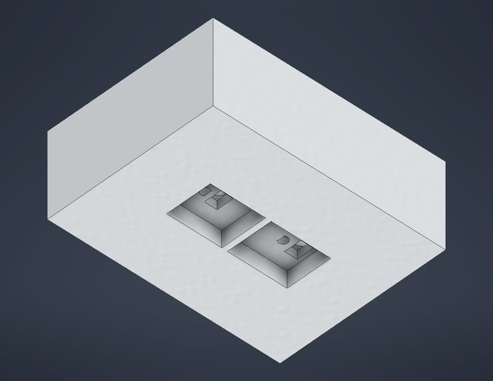

# Enclosure

Autodesk Inventor 2027 files for the reader's enclosure. Files saved in 2027
can't be opened in older Inventor versions.

## Opening

In Inventor, **Projects** → **Browse** → pick `Optical-Sensing-Device.ipj` in
this folder and make it active. The project's workspace is this folder (a
relative path), so it works wherever the repo is cloned. Open
`Enclosure Assembly.iam` for the whole device.

Without Inventor, open `Enclosure Assembly.step` / `Electronics Assembly.step`
in https://3dviewer.net or FreeCAD. Regenerate them with
`scripts/export_step.ps1` after changing the model.

## Layout

```
Optical-Sensing-Device.ipj   Inventor project file
Enclosure Assembly.iam       Everything: electronics, base, module, lid, a pouch and an LFA strip inserted
Electronics Assembly.iam     Perf board + ESP32 + TCS3448 + AS7343 + LCD + wiring
LFA Fit Check.iam            Electronics + an LFA strip sliding under both sensors (no enclosure)
Optics Test Jig.iam          Electronics on the test sled with one optical module, a pouch and a strip
Enclosure/                   Base, optical module and lid (generated by scripts/build_enclosure.ps1)
Electronics/                 Our simplified board models and the wiring
Purchased Parts/             Vendor models; don't edit, re-import instead
  Adafruit/                  TCS3448 breakout STEP and its Inventor import
  DetectaChem/               MobileDetect pouch (measured)
Test Strips/                 Bare LFA strip with T and C lines
Test Jig/                    Test sled and optical modules with 1.2-2.5 mm apertures
scripts/                     Generators for the electronics, enclosure, wiring and strip
*.png                        Renders used below
```

## Enclosure

Outside 96.5 × 89.5 × 49.2 mm, three printed parts: **base**, **optical
module** and **lid**. One module reads both tests:

- **Pouch (colorimetric):** slides in through the end wall under the ESP32,
  tip first, with about 9 mm left outside to pinch (finger notches above and
  below the slot). Its white pad stops under the TCS3448.
- **LFA strip:** slides in through the side wall (+Y) in a groove in the
  tunnel floor, 0.1 mm below the floor so the pouch slides over it. Its
  testing end stops at the groove's end with the T line under the TCS3448's
  view and the C line under the AS7343's. Read one test at a time.

| Distance below the sensor faces | |
|---|---|
| Pouch pad (top, 2 mm pad) | 11.15 mm |
| Module underside | 10.15 mm |
| Apertures (read chamber ceiling) | 7.25-8.75 mm |
| LFA strip | 13.25 mm |

| Feature | Part | What it does |
|---|---|---|
| Pouch tunnel | Base | 2 mm rails and a ceiling shelf following the pouch outline (+0.5 mm clearance). 8.9 mm tall near the entrance, where the ampoule bulge passes under the ESP32; 3 mm tall from X 44 on, where only the 0.8–2 mm pad end goes. Never narrows toward the entrance, so the whole pouch slides out; the tapered end stops and centres it |
| Strip groove | Base | 3.6 × 0.7 mm groove in the floor at X 70.40, from the stop at Y 11.19 out through the +Y wall |
| Module opening | Base | Opening above the tunnel with a pedestal underneath; the module drops in (0.2 mm gap each side) and its floor becomes the tunnel ceiling |
| Sensor pocket | Module | Holds both breakouts; walls rise to 0.2 mm under the perf board, which holds the module down |
| Optical block | Module | Solid black block under both breakouts (0.25 mm under their parts, recessed under the header pins). Per sensor it carries a **view bore** from the sensor down to a Ø1.6 mm aperture aimed at its LFA line, and an **LED bore** from the onboard white LED down to an exit slot just beside the aperture. Nothing else is open, so a sensor only sees light coming back up its own view bore. Thinnest wall between the two bores: 0.34 mm (TCS3448), 0.76 mm (AS7343) |
| Read chamber | Module | 2.9 mm recess in the module's underside over the read zone, split by a 1 mm wall between the sensors. It gives the LED light room to land where each sensor looks (the pouch pad is only 1 mm below the module elsewhere) |
| Board support | Base, lid | Corner posts in the base; matching clamp posts in the lid hold the board down |
| USB | Base | Opening in the +Y wall for a micro-USB plug (the connector is 11 mm in from the wall, so the plug's overmould has to pass through) |
| Lid | Lid | LCD window (LCD turned 90° so it reads from the pouch end), 4 bosses for the LCD's M3 screws, locating lip into the base |

| Optical module (top) | Underside | Section through both sensors |
|---|---|---|
|  |  |  |

Lighting uses each breakout's onboard white LED, switched by its sensor's LED
driver; the firmware still drives a single light on GPIO4 (#19), so it needs a
change to use them. Both boards face so each LED is on the +Y side of its
sensor. For the TCS3448 that is the side away from the lines, so the LED lights
the spot it views from about 40° on the opposite side and the pouch film's
mirror reflection can't get back up the view bore (the path would leave the LED
slot 2.4 mm past its end). The AS7343's LED sits between the sensors, so on a
glossy surface its reflection could reach its own view; only the matte strip
uses the AS7343.

Where the light lands (from `build_enclosure.ps1`):

| | Views | Lit |
|---|---|---|
| TCS3448 on the pouch pad | Y 31.35 | Y 29.5-34.2 |
| TCS3448 on the strip | Y 30.73 (T line) | Y 26.9-33.1 |
| AS7343 on the strip | Y 20.73 (C line) | Y 16.0-22.1 |

Dimming the LEDs in software changes glare and the real signal by the same
factor, so it doesn't reduce glare relative to the reading; use it to keep the
sensors out of saturation.

### Sliding the pouch and the strip

In `Enclosure Assembly.iam` both are held by constraints: on the floor, on
their centreline, and an insertion distance that is 0 when fully inserted.

| | Constraint (parameter) | Range |
|---|---|---|
| Pouch | **Pouch insertion** (`Insertion`) | 0–95 mm, out through the end wall |
| Strip | **Strip insertion** (`StripInsertion`) | 0–80 mm, out through the side wall |

The build script checks the pouch at 10 positions and the strip at 6 for
collisions with the enclosure.

- **Drag:** click and drag. The limits keep each one on its track, and it
  stays where you drop it.
- **Animate:** in the model browser, expand **Relationships**, right-click the
  constraint → **Drive**, set Start and End, press the forward button. Click
  **>>** in that dialog and tick **Record** to save a video.
- **Look inside:** View → **Half Section View** (display only; **End Section
  View** to go back). Don't add cut features to see inside.

The numbers live as named constants at the top of `scripts/Enclosure.cs`.
To change something, edit it, close the enclosure files in Inventor, delete
the three parts in `Enclosure/` and `Enclosure Assembly.iam`, and run:

```
powershell -ExecutionPolicy Bypass -File hardware\enclosure\scripts\build_enclosure.ps1
```

**Pouch numbers:** 3.75 × 2 in, 1 in front diagonals, ½ in second diagonals,
¾ in pad, 0.8 mm film and 2 mm pad thickness are measured. The diagonal
angles, the pad's distance from the tip (12.15 mm to its centre) and the
ampoule bulge (s 42–68 mm, 7.9 mm tall) come from the product image and
DetectaChem's spec; check them on a real pouch.

## Electronics assembly

Origin is the perf board's lower-left corner, +Z up. The perf board's top face
(wiring side) faces the lid; the ESP32 and both sensor breakouts hang below
it, component side down. Holes are written (column, row) from the lower-left
hole. `scripts/build_electronics.ps1` places the boards (`Electronics.cs`) and
regenerates the wiring (`Wiring.cs`).

| Part | Placement |
|---|---|
| Perf board | 90 × 70 × 1.6, 30 × 24 holes at 2.54, hole (0, 0) at (8.17, 5.79). Four Ø2 corner mounting holes 2.5 from the edges (approximate, from a photo) |
| ESP32 devkit | Matches the soldered board: turned 90°, USB toward +Y. Pins in columns 1 and 11, rows 7–21 (column 0 and rows 22–23 free); lowest point Z = −7.20 |
| TCS3448 breakout | Header along row 9, columns 22–27 (VIN at 27), board extending toward +Y so its LED is on the outer side. Reads the colorimetric pad and the LFA **test** line |
| AS7343 breakout | Same way round, header along row 2, so its board's edge touches the TCS3448's (both at Y 26.11). Reads the LFA **control** line |
| Sensor centres | TCS3448 (70.40, 34.62), AS7343 (70.40, 16.84): 17.8 mm apart, the closest the boards allow; faces at Z = −4.75. Onboard LEDs at Y 41.99 and 24.21 |
| 1602 I2C LCD | Turned 90°, above the wiring side, screen up. X 26.75–62.75, Y −5 to 75 (overhangs the board; it screws to the lid). Backpack bottom at Z = 8, screen top at Z = 29.3 |
| Pins above board | Up to Z = +6.0 until trimmed |

Both breakouts sit on 1×6 headers with a 2.5 mm plastic spacer. Adafruit has
no 3D model of the AS7343 board (6477) yet; its board file has the same
outline, holes, sensor position and header pinout as the TCS3448 board, so the
assembly reuses the TCS3448 model for it.

### Wiring

`Electronics/Wiring.ipt` models 22 AWG insulated wire on the perf board's top
face and loose leads up to the LCD backpack. Wires that cross run on raised
layers, so use insulated wire. Colours match the real board.


| Net | Colour | From | To |
|---|---|---|---|
| SDA | orange | ESP32 D21 (11, 11) | TCS3448 SDA (24, 9) → AS7343 SDA (24, 2); LCD pad (17, 23) |
| SCL | yellow | ESP32 D22 (11, 8) | TCS3448 SCL (25, 9) → AS7343 SCL (25, 2); LCD pad (16, 23) |
| 3V3 | red | ESP32 3V3 (11, 21) | TCS3448 VIN (27, 9) → AS7343 VIN (27, 2) |
| GND | black | ESP32 GND (11, 20) | TCS3448 GND (26, 9) → AS7343 GND (26, 2); LCD pad (19, 23) |
| 5V | white | ESP32 VIN (1, 21) | LCD pad (18, 23) |

The two sensor headers are the same way round, so the TCS3448 → AS7343 links
are four straight bridges down columns 24–27. Both sensors share the bus at
different addresses (TCS3448 0x59, AS7343 0x39; see `docs/dual-sensor-lfa.md`).
ESP32 D4 (11, 17) drove the old shared LED; with the onboard LEDs it is unused.

ESP32 pins follow the 30-pin DOIT layout (checked against our board's
silkscreen). Header order on both breakouts is VIN, GND, SCL, SDA, GPIO, INT
(from Adafruit's board files); turned this way it runs right to left.

**LCD at 5 V:** the I2C backpack's pull-ups go to its own supply, which would
pull SDA/SCL to 5 V on the ESP32's 3.3 V-only pins. Remove the backpack's two
pull-up resistors (usually marked 472) or add a level shifter before connecting
it.

**ESP32 and LCD dimensions are assumed** (ESP32: 51.5 × 28.5 PCB, rows 25.4
apart, pins centred, micro-USB; LCD: 80 × 36 PCB, M3 holes 2.5 from the edges,
71.2 × 24.2 × 7 bezel, 12.5 mm deep backpack). Check them against ours.

## LFA strip and fit check

`Test Strips/LFA Strip (bare).ipt` models the bare strip (measured, except
the 0.5 mm thickness, which is assumed):

| Feature | From the testing end |
|---|---|
| Strip | 75 mm long, 1/8 in (3.175 mm) wide |
| C (control) line | 10 mm, 1 mm wide, red |
| T (test) line | 20 mm, 1 mm wide, red |
| Far (sample) end | 75 mm |

`LFA Fit Check.iam` holds the electronics and the strip without the
enclosure, for checking the strip against the sensors on their own. The same
sliding strip is in `Enclosure Assembly.iam`. Fully inserted: testing end at
Y 10.73, lines centred between the sensors, T 3.89 mm inward of the TCS3448
and C 3.89 mm inward of the AS7343. Rebuild with
`scripts/build_lfa_fit_check.ps1` (delete `LFA Fit Check.iam` first).

## Optics test jig

Before printing the enclosure, print the jig and test the optics on the bench.
`Optics Test Jig.iam` puts the electronics on `Test Jig/Test Sled.ipt`: a 2 mm
floor plate under the whole perf board with posts at its corners, and a block
with the optical module's pocket, the pouch slot (open toward the ESP32 end)
and the strip groove (open toward the +Y side), all at the enclosure's heights.
`Test Jig/` also has the optical module with 1.2, 1.6, 2.0 and 2.5 mm
apertures (otherwise identical). The pouch and strip slide in it exactly as in
the enclosure (same constraints). Rebuild with `scripts/build_test_jig.ps1`
(delete `Test Jig/` and `Optics Test Jig.iam` first).

**Printing.** `exports/test-jig/` has each jig part as STEP (PrusaSlicer,
Bambu Studio, OrcaSlicer) and STL (Cura and others), in millimetres. Regenerate
them with `scripts/export_test_jig.ps1` after rebuilding the jig.

| Part | Size (mm) | Orientation | Notes |
|---|---|---|---|
| `Test Sled` | 90 × 70 × 19.9 | As exported, floor plate down | No supports |
| `Optical Module d1.2` … `d2.5` | 30.4 × 40.6 × 14.7 | As exported, underside (read chamber) down | No supports: the chamber ceiling is a short bridge and the bores are steep. The wall between a TCS3448's two bores is 0.34 mm, so use resin or a 0.25 mm nozzle at 0.1 mm layers. Matte black |

Check each aperture with a drill bit or pin gauge of its size; small holes often print undersize.

Cover the jig with a dark box while measuring. For each module, with the dual
firmware build (`python3 tools/run.py dual PORT`, press `l` / `c`):

1. **Dark:** light path blocked. Readings near zero.
2. **Blank strip:** clearly above dark, and repeatable when reinserted.
3. **Strip with lines:** green channels (around F4/F5) should drop at least
   about 10% from blank on a clear line.
4. **Crosstalk:** darken only the T line; the AS7343's reading shouldn't move.
5. **Pouch:** developed vs undeveloped pouch differ clearly, and nudging the
   pouch doesn't change the reading.

## Adafruit TCS3448 breakout (6525)

Source: [adafruit/Adafruit_CAD_Parts](https://github.com/adafruit/Adafruit_CAD_Parts/tree/main/6525%20TCS3448%20Light%20Color%20Sensor).
Origin is the board's lower-left corner, component side +Z. Measured from the
imported model (mm):

| Feature | Position / size |
|---|---|
| Board | 25.40 × 17.78, 1.07 thick, 2.54 corner radii |
| Mounting holes | 4 × M2.5 at (2.54, 2.54), (22.86, 2.54), (2.54, 15.24), (22.86, 15.24) |
| Spectral sensor | Centre (12.70, 8.51); top at z = 2.25 (1.18 above board) |
| Onboard white LED | Centre (12.70, 15.88); top at z = 1.85 |
| STEMMA QT connectors | Both short edges, y 5.89–11.89; top at z = 4.05 (tallest part) |
| Pin header | Row at y = 2.54, centred x = 12.70, 0.1" pitch |

The onboard LED sits above the chamber plate, so it can't light the pad
directly; leave it off in firmware anyway, since it can leak through the
aperture.
