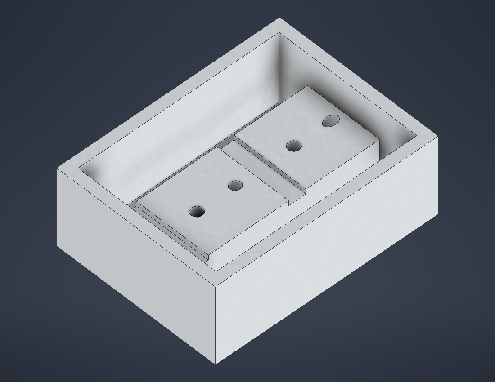
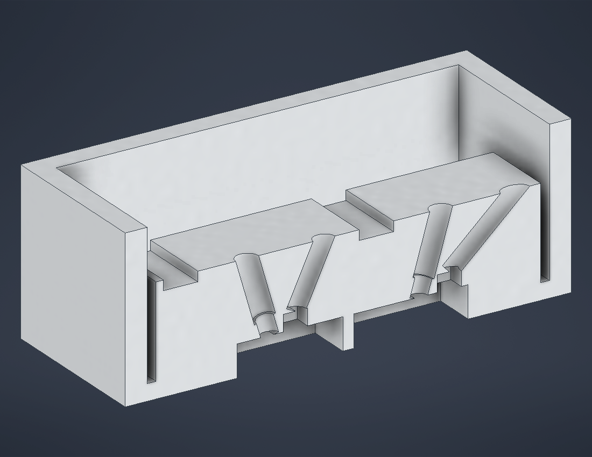
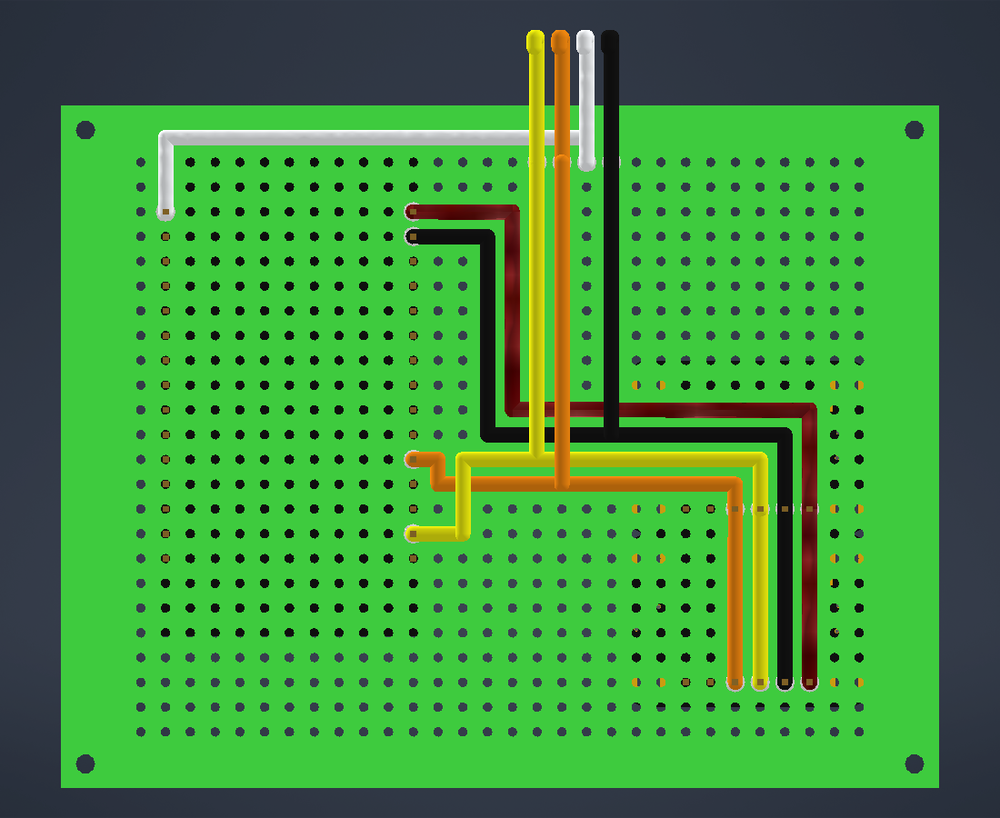

# Enclosure

Autodesk Inventor 2027 files for the reader's enclosure. Files saved in 2027
can't be opened in older Inventor versions.

## Opening

In Inventor, **Projects** → **Browse** → pick `Optical-Sensing-Device.ipj` in
this folder and make it active. The project's workspace is this folder (a
relative path), so it works wherever the repo is cloned. Open
`Enclosure Assembly.iam` for the whole device.

Without Inventor, open `Enclosure Assembly.step` / `Electronics Assembly.step`
in https://3dviewer.net or FreeCAD. Regenerate them with
`scripts/export_step.ps1` after changing the model.

## Layout

```
Optical-Sensing-Device.ipj   Inventor project file
Enclosure Assembly.iam       Everything: electronics, base, lid, a pouch inserted
Electronics Assembly.iam     Perf board + ESP32 + TCS3448 + LCD + wiring, as built
Enclosure/                   Base, optical module and lid (generated by scripts/build_enclosure.ps1)
Electronics/                 Our simplified board models and the wiring
Purchased Parts/             Vendor models; don't edit, re-import instead
  Adafruit/                  TCS3448 breakout STEP and its Inventor import
  DetectaChem/               MobileDetect pouch, approximate (from product image)
scripts/                     Generators for the enclosure and wiring
wiring-top.png               Wiring, top view
```

## Enclosure

Outside 96.5 × 89.5 × 61.1 mm. The pouch slides in through the end wall
under the ESP32, tip first, and only about 5 mm stays outside. Finger notches
above and below the slot let you pinch it out.

The device is three printed parts: **base**, **optical module** and **lid**.

| Feature | Part | What it does |
|---|---|---|
| Pouch tunnel | Base | 2 mm rails and a ceiling shelf following the pouch outline (+0.5 mm clearance), 9 mm tall. The tapered end stops and centres the pouch with the pad under the sensor |
| Module opening | Base | Hole in the tunnel shelf with a pedestal underneath; the optical module drops in (0.2 mm gap each side) and sits on the pedestal and rails |
| Light chamber | Module | Matte black box above the pad: 16 × 16 mm window onto the pad, Ø3 mm aperture under the sensor. Pad surface is 20 mm below the sensor face |
| TCS3448 pocket | Module | The module's walls rise to 0.2 mm under the perf board, so the breakout sits in a closed pocket; the perf board holds the module down |
| LED tunnels | Module | Two Ø5.2 mm bores at 45° (0/45 geometry, so the pouch film's glare misses the sensor), about 11 mm long including an Ø8 sleeve outside each wall. Fit 5 mm LEDs from outside |
| Diffuser recesses | Module | Ø10 × 1 mm recess on the inside of each LED tunnel for a diffuser disc (glue in) |
| Board support | Base, lid | Corner posts in the base; matching clamp posts in the lid hold the board down |
| USB | Opening in the side wall for a micro-USB plug |
| Lid | LCD window (LCD turned 90° so it reads from the pouch end), 4 bosses for the LCD's M3 screws, locating lip into the base |

### Sliding the pouch

In `Enclosure Assembly.iam` the pouch is held by three constraints: on the
tunnel floor, on the tunnel centreline, and **Pouch insertion** (parameter
`Insertion`): 0 mm is fully inserted, 95 mm is clear of the device. The tunnel
never narrows toward the entrance, so the whole pouch slides out; the build
script checks 10 positions from 0 to 100 mm for collisions.

- **Drag:** click and drag the pouch. **Pouch insertion** has limits
  (`InsertionMin` 0 mm, `InsertionMax` 95 mm), so it only moves along the
  tunnel between fully inserted and fully out, and stays where you drop it.
- **Animate:** in the model browser, expand **Relationships**, right-click
  **Pouch insertion** → **Drive**, set Start 0 mm and End 95 mm, press the
  forward button. Click **>>** in that dialog and tick **Record** to save a video.
- **Set a position:** double-click **Pouch insertion** and type a distance.
- **Look inside:** View → **Half Section View** (display only; **End Section
  View** to go back). Don't add cut features to see inside.

The optical module is separate so the optics can change (LED angle, aperture,
sensor height, an LFA version with a strip window) without reprinting the base.

| Optical module | Half-section through the sensor axis |
|---|---|
|  |  |

The numbers live as named constants at the top of `scripts/Enclosure.cs`.
To change something (pouch thickness, pad position, LED angle, clearances),
edit it, close the enclosure files in Inventor, delete the three parts in
`Enclosure/` and `Enclosure Assembly.iam`, and run:

```
powershell -ExecutionPolicy Bypass -File hardware\enclosure\scripts\build_enclosure.ps1
```

**Pouch numbers are partly assumed.** The outline is the product image scaled
to DetectaChem's published 1.98 × 3.54 × 0.31 in. That puts the white pad at
about 18 × 18 mm, centred, 11.5 mm from the bottom tip. The thickness at the
pad end (`PouchT`, 5 mm) is a guess. Measure a real pouch before printing.

## Electronics assembly

Origin is the perf board's lower-left corner, +Z up. The perf board's top face
(wiring side) faces the lid; the ESP32 and TCS3448 hang below it, component
side down. Holes are written (column, row) from the lower-left hole.

| Part | Placement |
|---|---|
| Perf board | 90 × 70 × 1.6, 30 × 24 holes at 2.54, hole (0, 0) at (8.17, 5.79) |
| ESP32 devkit | Turned 90°, USB toward the +Y wall. Pins in columns 0 and 10, rows 9–23; lowest point Z = −7.20 |
| TCS3448 breakout | Header in column 22, rows 9–14, on a 2.5 mm plastic spacer |
| Spectral sensor | Centre (70.02, 35.00), face at Z = −4.75 |
| 1602 I2C LCD | Turned 90°, above the wiring side, screen up. X 26.75–62.75, Y −5 to 75 (overhangs the board; it screws to the lid). Backpack bottom at Z = 8, screen top at Z = 29.3 |
| Pins above board | Up to Z = +6.0 until trimmed |

### Wiring

`Electronics/Wiring.ipt` (generated by `scripts/build_wiring.ps1`) models
22 AWG insulated wire on the perf board's top face and loose leads up to the
LCD backpack. Wires that cross run on a raised layer, so use insulated wire.



| Net | Colour | From | To |
|---|---|---|---|
| SCL | yellow | ESP32 D22 (10, 10) | TCS3448 SCL (22, 11); LCD pad (26, 23) |
| SDA | blue | ESP32 D21 (10, 13) | TCS3448 SDA (22, 12); LCD pad (27, 23) |
| 3V3 | red | ESP32 3V3 (10, 23) | TCS3448 VIN (22, 9) |
| GND | black | ESP32 GND (10, 22) | TCS3448 GND (22, 10); LCD pad (29, 23) |
| 5V | orange | ESP32 VIN (0, 23) | LCD pad (28, 23) |

ESP32 pins follow the 30-pin DOIT layout (checked against our board's
silkscreen). TCS3448 header order is VIN, GND, SCL, SDA, GPIO, INT (from
Adafruit's board file).

**LCD at 5 V:** the I2C backpack's pull-ups go to its own supply, which would
pull SDA/SCL to 5 V on the ESP32's 3.3 V-only pins. Remove the backpack's two
pull-up resistors (usually marked 472) or add a level shifter before connecting
it.

**ESP32 and LCD dimensions are assumed** (ESP32: 51.5 × 28.5 PCB, rows 25.4
apart, pins centred, micro-USB; LCD: 80 × 36 PCB, M3 holes 2.5 from the edges,
71.2 × 24.2 × 7 bezel, 12.5 mm deep backpack). Check them against ours.

## Adafruit TCS3448 breakout (6525)

Source: [adafruit/Adafruit_CAD_Parts](https://github.com/adafruit/Adafruit_CAD_Parts/tree/main/6525%20TCS3448%20Light%20Color%20Sensor).
Origin is the board's lower-left corner, component side +Z. Measured from the
imported model (mm):

| Feature | Position / size |
|---|---|
| Board | 25.40 × 17.78, 1.07 thick, 2.54 corner radii |
| Mounting holes | 4 × M2.5 at (2.54, 2.54), (22.86, 2.54), (2.54, 15.24), (22.86, 15.24) |
| Spectral sensor | Centre (12.70, 8.51); top at z = 2.25 (1.18 above board) |
| Onboard white LED | Centre (12.70, 15.88); top at z = 1.85 |
| STEMMA QT connectors | Both short edges, y 5.89–11.89; top at z = 4.05 (tallest part) |
| Pin header | Row at y = 2.54, centred x = 12.70, 0.1" pitch |

The onboard LED sits above the chamber plate, so it can't light the pad
directly; leave it off in firmware anyway, since it can leak through the
aperture.
