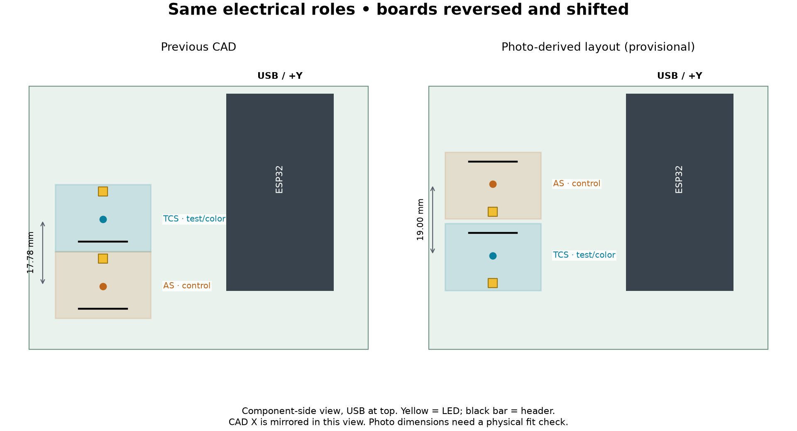
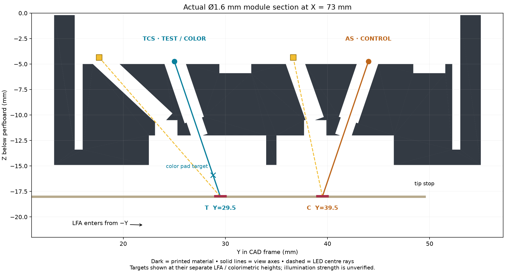

# Enclosure: photographed board layout

**Provisional prototype, November 12, 2026.** The boards in `IMG_7890` and
`IMG_7891` are the final physical arrangement, as confirmed by Arun. The new
geometry follows that orientation. XY positions were estimated from the
2.54 mm grid; spacer heights and several enclosure dimensions remain inherited
assumptions. Print the alignment gauge before the full case.

**Open the updated models in [exports/as-built/](exports/as-built/).**
`Enclosure LFA.step` and `Enclosure Color.step` are separate configurations;
`Test Jig LFA.step` / `Test Jig Color.step` show the bench fixture. The eight
printable parts each have STEP and STL files in millimetres.

**The root `.iam` / `.ipt` files and old PNG renders still describe the
previous layout.** They are retained as Inventor rebuild inputs. The C#
generators are updated, but native files have not been regenerated or validated
on this Mac. The root `Enclosure Assembly.step` now mirrors the new LFA
assembly, `Electronics Assembly.step` mirrors the new electronics, and
`exports/test-jig/` mirrors the new printable jig parts. These neutral files
therefore do not yet match the legacy native files. The PR stays draft pending
physical fit and the Windows/Inventor rebuild.



## What changed

| Area | Previous model | New prototype |
|---|---|---|
| Board order | TCS above AS, viewed with USB at top | AS above TCS, matching both photos |
| Board orientation | LEDs toward +Y; headers toward −Y | Both rotated 180° in their mounting plane: LEDs toward −Y; headers toward +Y |
| Sensor centres | TCS (70.40, 34.62), AS (70.40, 16.84) | TCS (73, 25), AS (73, 44) mm; **photo estimates** |
| Board spacing | 17.78 mm, edges touching | 19 mm sensor spacing; nominal 1.22 mm between board edges |
| Pocket / optical block | Positioned for old boards and pins | Shifted, lengthened, header recesses moved; clearance for STEMMA connectors retained |
| Viewing paths | TCS aimed toward lower Y, AS toward higher Y | TCS aimed toward higher Y at T; AS toward lower Y at C |
| Lighting paths | Slots on +Y side of apertures | Bores and slots moved to −Y; slot-to-aperture lip spacing increased to 0.8 mm |
| Read chamber | Split for old line positions | Both chambers and central divider relocated |
| LFA entry | From +Y | **From −Y**, testing tip toward +Y; stop Y=49.5, T at 29.5, C at 39.5 |
| Color pouch | Old tunnel centreline | Tunnel, taper, finger notches and pad target shifted to Y≈28.79; entry still from −X |
| Base / test sled | Old module opening and groove | New locating pocket, reversed groove and entry slot; pouch clearance cut through corner supports |
| Shelf joint | Could meet pedestal along an edge | 0.2 mm overlap below shelf gives a solid connection and closed STL |
| Wiring geometry | Old hole coordinates and routed wires | Updated pin-net markers; no invented routes for the unseen solder side |
| Sources / outputs | Inventor-only generation | Shared JSON → generated C# constants; CadQuery generator, alignment gauge, STEP/STL, checks and diagrams |
| Firmware | TCS test/color; AS control | Same roles, addresses, GPIOs and channel ordering; no firmware source changed |

The outer enclosure remains 96.5 × 89.5 × 49.2 mm. LCD and USB placement are
inherited mechanical references, not newly verified against these photos.
This revision does not add a power-bank compartment.

## Coordinates and uncertainty

CAD frame: lower-left of the 90 × 70 mm perfboard **viewed from the solder
side**, +Y toward USB, board bottom Z=0, components toward −Z. The supplied
photos show the component side, so horizontal position is mirrored in CAD.

The close photo appears to show **31 × 26** round grid holes, versus the old
CAD's 30 × 24. A centred 31 × 26 grid at 2.54 mm gives an assumed origin of
(6.90, 3.25). Perspective/grid projection puts the sensor centres near
(72.8, 24.6) and (72.9, 43.7); the model deliberately rounds these to
(73, 25) and (73, 44). Raised boards, perspective, pad picking and grid-origin
uncertainty prevent treating these as measured solder-hole assignments.
Allow **±1.5 mm for the initial physical check**; that is a planning allowance,
not a measured tolerance or statistical confidence interval.

`as-built-layout.json` is the editable source for these positions and the
roles. The code derives board outlines, pin coordinates, LED centres, line
targets, divider, strip stop and pouch alignment from it. Nominal values:

| Feature | TCS3448 | AS7343 |
|---|---:|---:|
| Sensor centre XY | (73, 25) | (73, 44) |
| Header Y | 30.969 | 49.969 |
| Onboard LED Y | 17.634 | 36.634 |
| View target on strip Y | 29.5 (T) | 39.5 (C) |
| Sensor face Z | −4.75 | −4.75 |
| LED face Z | −4.35 | −4.35 |

Board back Z=−2.5, strip top Z=−18, pouch-pad top Z=−15.9 are inherited
assumptions. AS still uses the TCS vendor model as a mechanical proxy; check
its actual component heights. The neutral assemblies omit copper/mask and
very small passives for file size and show an outline-only perfboard. Full
vendor solids are used for the board/module interference checks. ESP32/LCD
reference origins and provenance are in [reference/README.md](reference/README.md).

## Optical behaviour



Each view axis tilts about 18.8° inward to put the two targets 10 mm apart
under sensors about 19 mm apart. TCS stays on the test line and the pouch pad;
AS stays on control. **Verify actual strip T/C labels**: the model inherits C
10 mm and T 20 mm from the testing tip, rather than assuming every assay has
that order.

The TCS LED remains outside the sensor pair and the AS LED between the two
sensors. Rotating the optical paths preserves this arrangement. Black bore
walls and a divider separate the channels. Actual kernel-measured minimum
view/LED bore separation is about **0.56 mm** on TCS and at least **0.83 mm**
on AS across the four modules. This does not establish optical isolation:
light can still scatter in the sample gap or reflect from glossy film.

Geometric checks find an open view axis and at least one unobstructed sampled
LED ray to each intended target for every aperture. That proves a possible
straight path, not adequate brightness, uniformity, optical footprint or
rejection of glare. Bench-test those properties before choosing an aperture.

## Print and set up

1. Print `Alignment Gauge.stl` at **100% scale**. It is a 90 × 70 × 2 mm
   reference template with a USB-side notch and combined breakout window.
   Register it to the perfboard outline without pressing on components. Check
   the board window, spacing and position. Corner holes are inherited estimates.
   Measure sensor X/Y and face height if the template is off; update the JSON
   and regenerate before printing larger parts. The gauge checks outlines,
   not sensor-centre accuracy or standoff height.
2. Print `Test Sled.stl` and `Optical Module d1.6.stl` first. The other modules
   have 1.2, 2.0 and 2.5 mm view apertures. Use opaque matte black material for
   the module; inspect bores and chamber roofs in the slicer. Use a process
   that resolves the roughly 0.56 mm wall and small bores; do not assume
   support-free printing or that nominal aperture size equals printed size.
   STL coordinates preserve the CAD frame: place the part's underside on the
   build plate. Inspect and gauge each aperture after printing.
3. Dry-fit without forcing the sensor boards. Confirm clearance at headers,
   STEMMA connectors, sensor faces and LEDs. Check board tilt and spacer height.
4. Insert an LFA strip from the **−Y side**, with the inherited testing tip
   pointing +Y. At the stop, confirm T is in TCS's view and C in AS's view.
   The color pouch still inserts tip-first from −X. Use one sample at a time.
5. Verify wiring by **silkscreen pin names**, not old row numbers. See
   [WIRING.md](../WIRING.md). Board rotation does not swap I2C addresses or
   the firmware's spectral channels.
6. Flash the current dual-sensor build with onboard lighting enabled:
   `python3 tools/run.py dual PORT --sensor-leds` (default 20 mA), then `l`
   for LFA or `c` for color. Use the same LED current/gain/exposure for all
   references and test samples. The existing firmware lights both healthy
   boards together, including in color mode; color **sampling** uses TCS only.
7. Cover the jig with a dark enclosure. Record repeated dark, blank membrane,
   known positive/negative/faint/invalid strips and blank/developed pouches.
   Cover each zone independently to check role assignment and crosstalk.
   Check repeat insertion, ambient-light sensitivity, saturation and film glare.
8. Recalibrate **both** modes in the final geometry. Populate the separate LFA
   dark/blank references and validated thresholds; remeasure color references.
   Old cardboard-rig references are not validated for this optical module.
   See [dual-sensor setup](../../docs/dual-sensor-lfa.md).
9. Only after the jig fits and optical tests pass, print the base and lid.
   Verify LCD, cable clearance and pouch/strip thickness against the actual parts.

`INVALID` / `calibration=missing_or_invalid` is expected until valid LFA
references are installed. CAD changes do not repair `ESP_ERR_INVALID_RESPONSE`
or prove the AS7343 SMUX warnings in Isaac's log are resolved.

## Rebuild the neutral CAD on Mac, Linux or Windows

Use Python 3.10+ (tested here with Python 3.12.16):

```sh
python3 -m venv /tmp/capstone-cad
/tmp/capstone-cad/bin/python -m pip install -r hardware/enclosure/scripts/requirements-cad.txt
/tmp/capstone-cad/bin/python hardware/enclosure/scripts/layout.py
/tmp/capstone-cad/bin/python hardware/enclosure/scripts/build_as_built.py
/tmp/capstone-cad/bin/python hardware/enclosure/scripts/render_as_built.py
```

On Windows use the venv's `Scripts/python.exe`. Generated output goes to
`exports/as-built/`; `--out PATH` selects another output folder. The build
fails on stale C# constants, overlapping breakouts, invalid solids, open or
non-manifold STL edges, STEP round-trip errors, intersecting view/LED bores,
blocked sampled optical paths or insertion collisions.

[validation.json](exports/as-built/validation.json) records the layout hash,
source/export hashes, part bounds/volumes, checks and remaining limitations.
CI runs `python hardware/enclosure/scripts/check_cad_artifacts.py` to detect
stale sources, exports, compatibility copies or failed recorded checks; it
does not rerun the CAD kernel. In this
build, eight single-solid parts pass, all STEP volumes round-trip, and all STL
edges have two incident facets. Strip travel was checked at 81 positions and
pouch travel at 96 positions for **each** of the enclosure and sled, with zero
modeled collision volume. This is discrete mechanical verification, not
physical acceptance or exhaustive continuous motion/optical simulation.

## Rebuild native Inventor files (pending)

The C# sources use the same generated `AsBuiltLayout.cs`. On Windows with
Inventor 2027 running, save/close its documents and use a fresh PowerShell:

```powershell
powershell -ExecutionPolicy Bypass -File hardware\enclosure\scripts\rebuild_as_built.ps1
```

This copies the reference inputs into a **new** isolated project at
`exports/as-built-native/`, activates it, repositions the boards, replaces the
old routed-wire model with pin-net markers, regenerates enclosure/jig/strip
parts and constraints, and saves collision logs. The native STEP export scripts now default to this
isolated build directory, so they cannot overwrite current neutral exports
with the old source assemblies. It refuses an existing
output directory; pass `-Destination PATH` for another build. Source native
files are retained. Verify Inventor reference resolution, C# compilation,
constraint travel, fit and exports on that machine before promoting those
native files. The native workflow has not been executed here.
